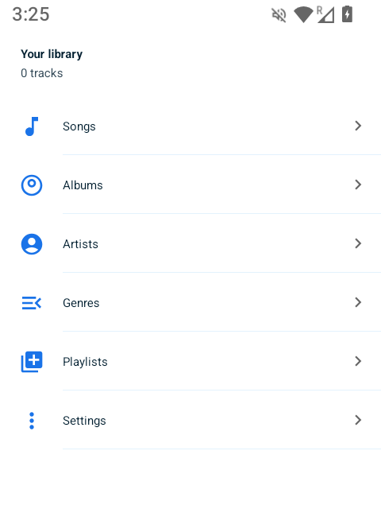
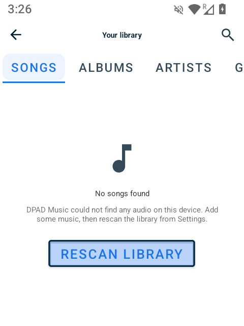
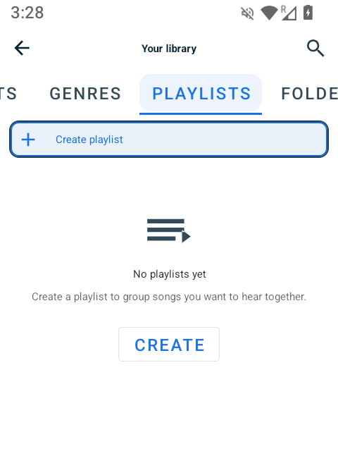
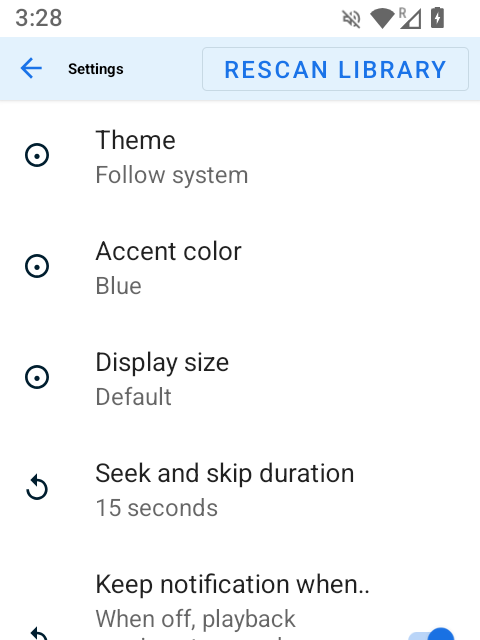

# D-PAD Player

A local music player designed for D-pad, keyboard, and remote-control navigation. Browse music on your device, manage your queue, and control playback without needing touch.

[](https://github.com/jbriones95/D-PAD-Player/releases/latest)
[](https://github.com/jbriones95/D-PAD-Player/actions/workflows/android-ci.yml)
[](LICENSE)

## Download

Get the latest signed APK from [GitHub Releases](https://github.com/jbriones95/D-PAD-Player/releases/latest). Install it on your Android device and allow music access when prompted.

## Screenshots

<table>
  <tr>
    <td align="center"><strong>Library</strong><br></td>
    <td align="center"><strong>Songs</strong><br></td>
  </tr>
  <tr>
    <td align="center"><strong>Playlists</strong><br></td>
    <td align="center"><strong>Display settings</strong><br></td>
  </tr>
</table>

## Features

- **D-pad friendly:** Move through the library, player, queue, and settings with a remote or keyboard.
- **Browse your music:** View songs, albums, artists, genres, playlists, folders, recent tracks, and top tracks.
- **Search and organize:** Search your library, create playlists, and import or export M3U playlists.
- **Playback controls:** Use the queue, shuffle, repeat, sleep timer, playback speed, and equalizer.
- **Background playback:** Keep music playing with notification and media-button controls.
- **Make it comfortable:** Choose Small, Default, or Large display size, plus light/dark themes and accent colors.
- **Shared DPAD branding:** The app icon and default blue match DPAD SMS/Messaging.

## Build from source

### Requirements

- Android Studio or Android SDK
- Java 17

### Build and test

From the project root, run:

```bash
./gradlew :app:testDebugUnitTest :app:lintDebug :app:assembleDebug
```

The debug APK is written to `app/build/outputs/apk/debug/dpadmp3.apk`. To install it on a connected device:

```bash
adb install -r app/build/outputs/apk/debug/dpadmp3.apk
```

Release APKs are built and signed by [GitHub Actions](https://github.com/jbriones95/D-PAD-Player/actions/workflows/android-release.yml) and published on the [releases page](https://github.com/jbriones95/D-PAD-Player/releases).

## Changelog

See [CHANGELOG.md](CHANGELOG.md) for recent updates.

## License

Released under the [MIT License](LICENSE).
